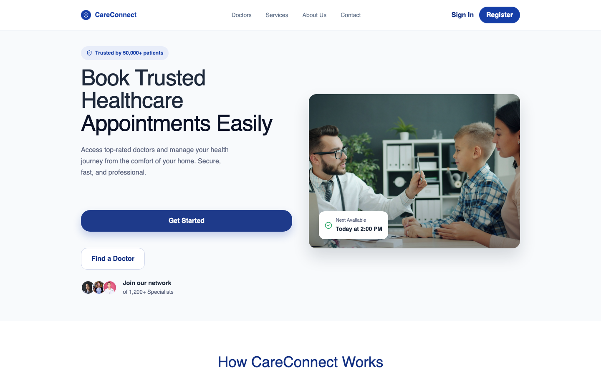
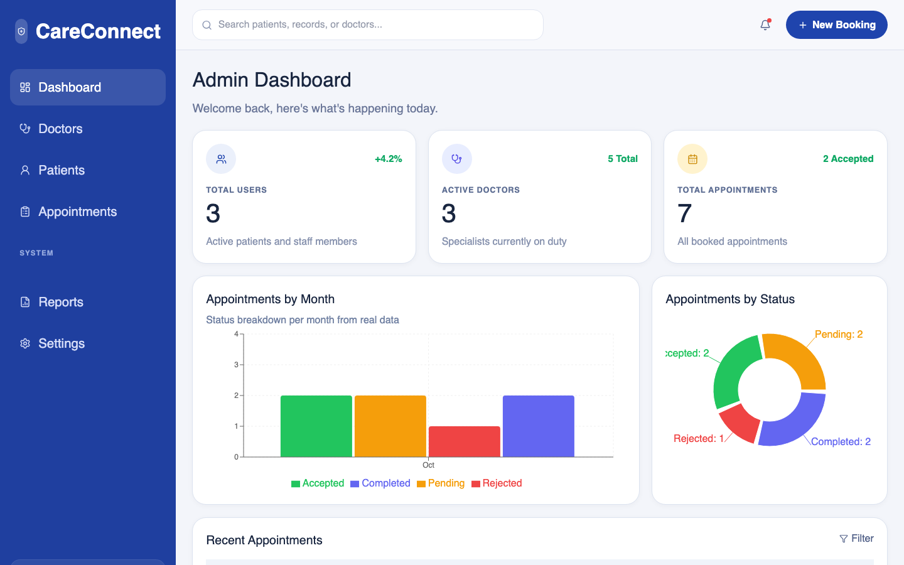
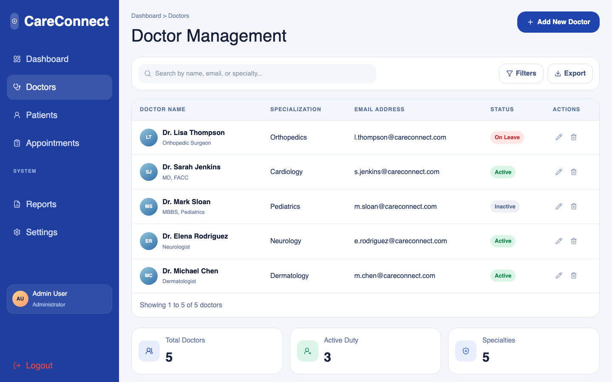
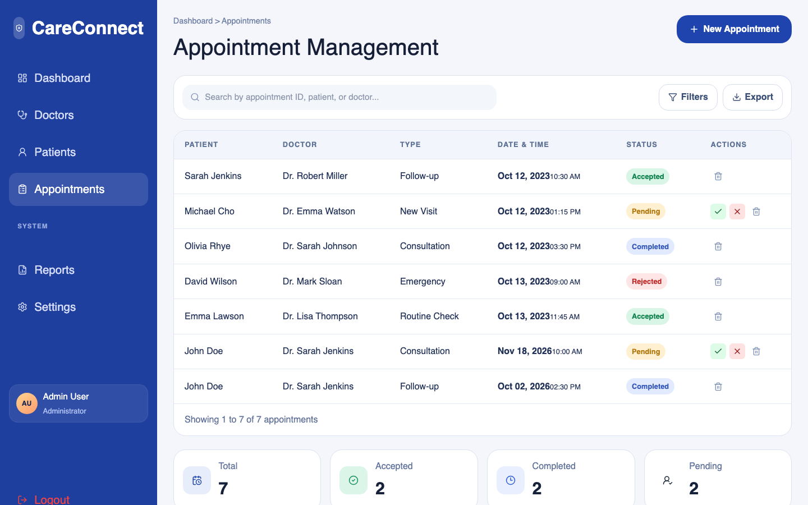
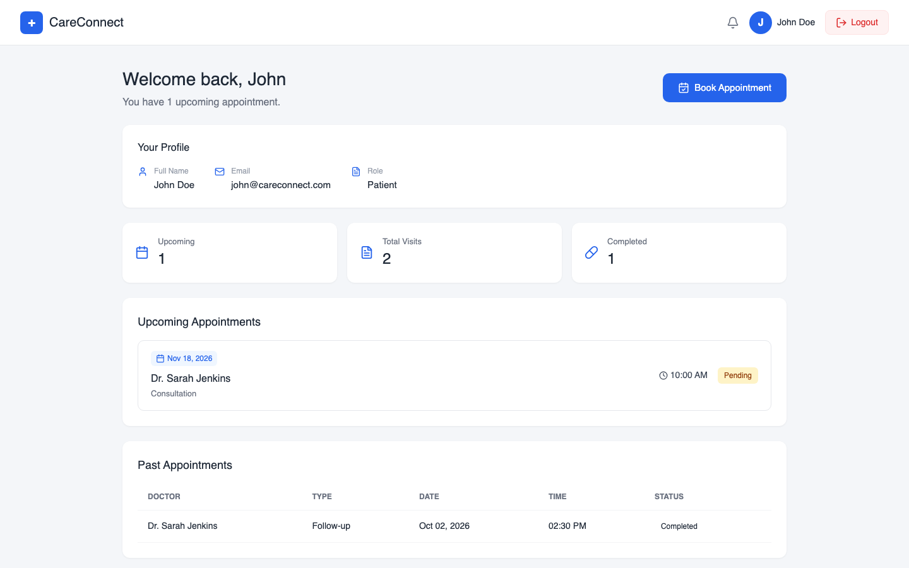
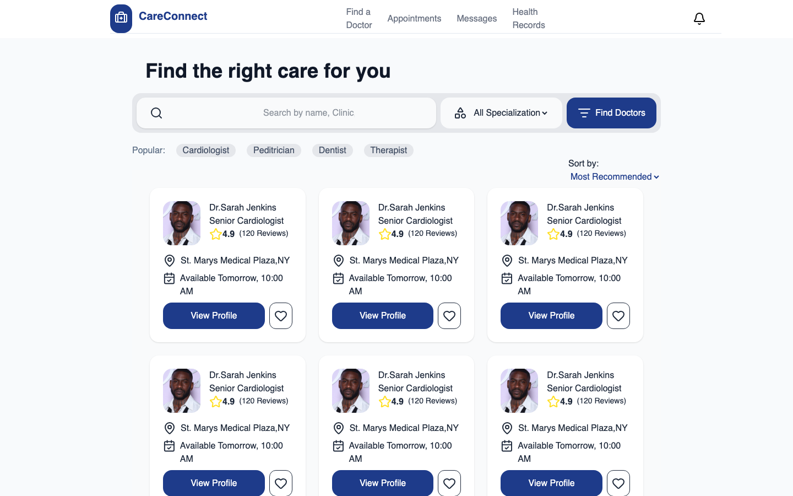
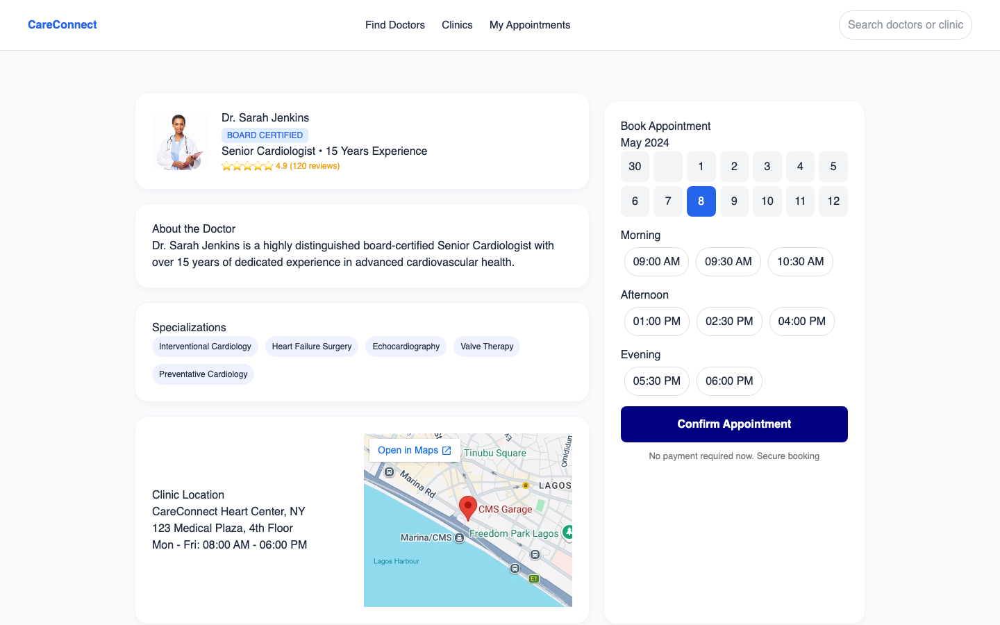
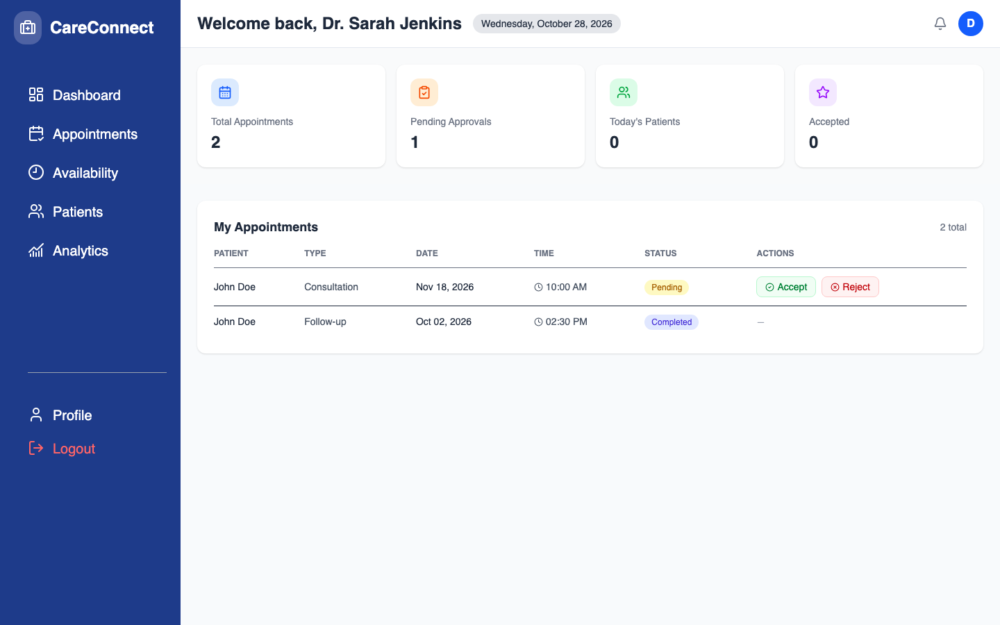
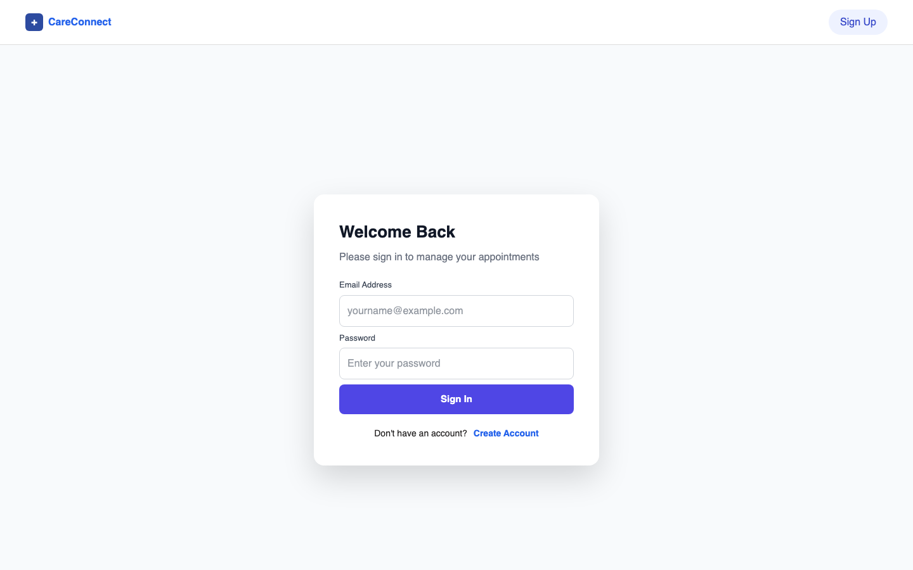
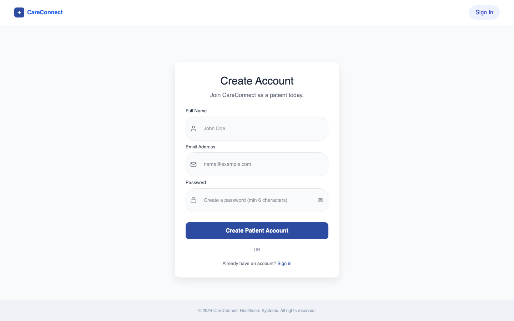

# CareConnect

A full-stack healthcare appointment platform that connects **patients**, **doctors**, and **clinic administrators** in one place. Patients can find doctors and book appointments, doctors can manage their schedule, and admins get a dashboard to manage the whole practice.

Built with **React 19 + Vite + Tailwind CSS** on the frontend and **Node.js + Express + MongoDB** on the backend, with JWT-based authentication and role-based access control.

---

## Screenshots

### Landing page


### Admin


<table>
  <tr>
    <td width="50%"><strong>Doctor management</strong><br></td>
    <td width="50%"><strong>Appointment management</strong><br></td>
  </tr>
</table>

### Patient
<table>
  <tr>
    <td width="50%"><strong>Patient dashboard</strong><br></td>
    <td width="50%"><strong>Find a doctor</strong><br></td>
  </tr>
</table>



### Doctor


### Authentication
<table>
  <tr>
    <td width="50%"><strong>Sign in</strong><br></td>
    <td width="50%"><strong>Patient registration</strong><br></td>
  </tr>
</table>

---

## Features

### Patients
- Register and log in securely
- Browse and search doctors by specialization
- View doctor profiles (credentials, bio, rating, location)
- Book appointments
- Personal dashboard with upcoming appointments

### Doctors
- Dedicated doctor dashboard
- View and manage incoming appointments (accept / update status)
- Find and view other doctors

### Admins
- Analytics dashboard with charts (Recharts)
- Full CRUD for **doctors**, **patients**, and **appointments**
- Create additional admin accounts
- Reports and settings pages

### Platform
- JWT authentication with role-based protected routes (`patient`, `doctor`, `admin`)
- Passwords hashed with bcrypt
- In-app notifications
- Seed script with realistic demo data

---

## Tech Stack

| Layer     | Technology                                                   |
| --------- | ------------------------------------------------------------ |
| Frontend  | React 19, React Router 7, Vite 7, Tailwind CSS 4, Recharts, Lucide / React Icons |
| Backend   | Node.js, Express 5                                           |
| Database  | MongoDB with Mongoose                                        |
| Auth      | JSON Web Tokens (jsonwebtoken), bcryptjs                     |
| Tooling   | ESLint                                                       |

---

## Project Structure

```
CareConnect/
├── server/                 # Express REST API
│   ├── config/db.js        # MongoDB connection
│   ├── middleware/auth.js  # JWT auth + admin guard
│   ├── models/             # User, Doctor, Patient, Appointment, Notification
│   ├── routes/             # auth, doctors, patients, appointments, dashboard, notifications
│   ├── seed.js             # Demo data seeder
│   └── index.js            # API entry point
├── src/                    # React frontend
│   ├── components/         # Shared UI (landing, admin, doctors)
│   ├── context/            # AuthContext (user session state)
│   ├── layouts/            # Admin layout
│   ├── pages/              # Landing, auth, admin, doctor and patient pages
│   ├── services/api.js     # API client
│   └── App.jsx             # Routes + role-based protection
├── .env.example
├── vite.config.js          # Proxies /api to the backend in dev
└── package.json
```

---

## Getting Started

### Prerequisites
- [Node.js](https://nodejs.org/) 18 or newer
- [MongoDB](https://www.mongodb.com/) — a local instance or a free [MongoDB Atlas](https://www.mongodb.com/atlas) cluster

### 1. Clone and install

```bash
git clone https://github.com/tivere-dev/CareConnect.git
cd CareConnect
npm install
```

### 2. Configure environment variables

Copy the example file and fill in your values:

```bash
cp .env.example .env
```

| Variable      | Description                               |
| ------------- | ----------------------------------------- |
| `MONGODB_URI` | MongoDB connection string                 |
| `JWT_SECRET`  | Any long random string used to sign JWTs  |
| `PORT`        | API port (defaults to `5000`)             |

### 3. Seed the database (optional, recommended)

```bash
npm run seed
```

### 4. Run the app

Start the API and the frontend in two terminals:

```bash
npm run server
```

```bash
npm run dev
```

The frontend runs at `http://localhost:5173` and proxies `/api` requests to the backend on port `5000`.

### Demo accounts

After seeding, you can log in with:

| Role    | Email                   | Password     |
| ------- | ----------------------- | ------------ |
| Admin   | admin@careconnect.com   | admin123     |
| Doctor  | sarah@careconnect.com   | doctor123    |
| Patient | john@careconnect.com    | patient123   |

> These are demo credentials for local development only.

---

## API Overview

All endpoints are prefixed with `/api`.

| Method | Endpoint                          | Description                         | Access                    |
| ------ | --------------------------------- | ----------------------------------- | ------------------------- |
| POST   | `/auth/register`                  | Register a new user                 | Public                    |
| POST   | `/auth/login`                     | Log in and receive a JWT            | Public                    |
| GET    | `/auth/me`                        | Get the current user                | Logged in                 |
| POST   | `/auth/create-admin`              | Create an admin account             | Admin                     |
| GET    | `/doctors`, `/doctors/:id`        | Browse doctors                      | Public                    |
| POST / PUT / DELETE | `/doctors[/:id]`     | Create, update, delete doctors      | Admin                     |
| ALL    | `/patients[/:id]`                 | Manage patient records              | Admin                     |
| GET    | `/appointments`, `/appointments/:id` | View appointments                | Logged in (own only*)     |
| POST   | `/appointments`                   | Book an appointment                 | Logged in                 |
| PUT / DELETE | `/appointments/:id`         | Update or delete an appointment     | Admin                     |
| PATCH  | `/appointments/:id/status`        | Accept / reject / complete          | Admin or assigned doctor  |
| GET    | `/dashboard/stats`                | Admin dashboard statistics          | Admin                     |
| GET    | `/notifications`                  | Get the user's notifications        | Logged in                 |
| PATCH  | `/notifications/:id/read`         | Mark a notification as read         | Logged in                 |
| GET    | `/health`                         | Health check                        | Public                    |

\* Appointments are linked to patient and doctor **user accounts by ID**, so patients only see their own appointments and doctors only see those assigned to them, even when two users share a name; admins see everything. Appointments booked by patients always start as `Pending`.

------ | --------------------------------- | ------------------------------- | ----------- |
| POST   | `/auth/register`                  | Register a new user             | —           |
| POST   | `/auth/login`                     | Log in and receive a JWT        | —           |
| GET    | `/auth/me`                        | Get the current user            | User        |
| POST   | `/auth/create-admin`              | Create an admin account         | Admin       |
| GET    | `/doctors`                        | List doctors                    | —           |
| GET    | `/doctors/:id`                    | Get a doctor                    | —           |
| POST / PUT / DELETE | `/doctors[/:id]`     | Create, update, delete doctors  | —           |
| GET    | `/patients`                       | List patients                   | —           |
| POST / PUT / DELETE | `/patients[/:id]`    | Create, update, delete patients | —           |
| GET    | `/appointments`                   | List appointments               | —           |
| POST / PUT / DELETE | `/appointments[/:id]`| Create, update, delete appointments | —       |
| PATCH  | `/appointments/:id/status`        | Update appointment status       | User        |
| GET    | `/dashboard/stats`                | Admin dashboard statistics      | —           |
| GET    | `/notifications`                  | Get the user's notifications    | User        |
| PATCH  | `/notifications/:id/read`         | Mark a notification as read     | User        |
| GET    | `/health`                         | Health check                    | —           |

---

## Scripts

| Command          | Description                          |
| ---------------- | ------------------------------------ |
| `npm run dev`    | Start the Vite dev server            |
| `npm run server` | Start the Express API                |
| `npm run seed`   | Reset and seed the database          |
| `npm run migrate:links` | Link existing appointments to user accounts (one-time, for older data) |
| `npm run build`  | Build the frontend for production    |
| `npm run preview`| Preview the production build         |
| `npm run lint`   | Run ESLint                           |

---

## Team

- **Tivere Madagwa** — lead developer: built most of the React frontend and the full backend (Express API, MongoDB models, JWT authentication, role-based access)
- **Finidi** — contributor

---

## Roadmap

- Deploy (frontend on Vercel/Netlify, API on Render/Railway, database on Atlas)
- Email/SMS appointment reminders
- Automated tests
